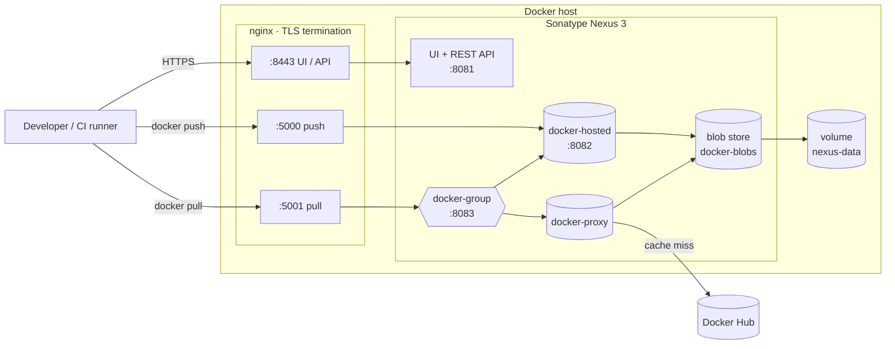

# Nexus Docker Registry

[](https://github.com/<your-github-username>/nexus-docker-registry/actions/workflows/ci.yml)


A private Docker image registry built on **Sonatype Nexus Repository**. Run one command and you get HTTPS, a Docker Hub pull-through cache, immutable release tags, least-privilege CI credentials, scheduled cleanup and backups. A CI pipeline deploys the whole stack and tests it on every commit.

```bash
make deploy        # TLS certs → start stack → configure Nexus via REST API
make smoke-test    # build → push → verify → pull → run → check policies
```

---

## Table of contents

- [Features](#features)
- [Architecture](#architecture)
- [Quick start](#quick-start)
- [Using the registry](#using-the-registry)
- [CI/CD integration](#cicd-integration)
- [Configuration](#configuration)
- [What the bootstrap configures](#what-the-bootstrap-configures)
- [Security](#security)
- [Operations](#operations)
- [Design decisions](#design-decisions)
- [Production checklist](#production-checklist)
- [Project structure](#project-structure)

---

## Features

| Area | What you get |
|------|--------------|
| **Registry** | `docker-hosted` for your images, `docker-proxy` to cache Docker Hub, and `docker-group` to pull both from one endpoint |
| **TLS** | Nginx terminates TLS 1.2/1.3 with HSTS. Layers stream to Nexus without buffering, so pushes of any size work |
| **Infrastructure as code** | All configuration is applied through the Nexus REST API from versioned JSON files. Nothing is set up by clicking in the UI |
| **Idempotent** | `make bootstrap` creates whatever is missing and corrects anything that has drifted. It is safe to re-run |
| **Immutable releases** | The `allow_once` write policy blocks overwriting a tag. Only `latest` can be redeployed |
| **Least privilege** | The CI service account can push to `docker-hosted` and pull from `docker-group`, and nothing else |
| **Housekeeping** | Scheduled tasks garbage-collect unused images, purge stale cache entries, compact the blob store and back up the database |
| **Backup / restore** | A cold backup of the volume with retention, and a guarded restore |
| **Hardening** | The Nexus ports are never published on the host. The proxy runs read-only with `no-new-privileges`. Versions are pinned, logs rotate, ulimits are set |
| **Tested in CI** | Lint (ShellCheck, Hadolint, `nginx -t`, compose config), then a full deploy → bootstrap ×2 → push/pull → backup run on every PR |

## Architecture



**Why separate push and pull ports?** In Nexus Community Edition you can't push to a group repository. Pulls go through `docker-group`, which serves your own images and cached Docker Hub images from one URL. Pushes go straight to `docker-hosted`.

## Quick start

**Prerequisites:** Docker Engine 24+ with Compose v2, `make`, `curl`, `jq`, `openssl`, and about 4 GB of free RAM.

```bash
git clone https://github.com/<your-github-username>/nexus-docker-registry.git
cd nexus-docker-registry

make env          # creates .env from .env.example. Edit the passwords now.
make deploy       # generate certs, start the stack, configure Nexus
make smoke-test   # optional: run the end-to-end check
```

The first start takes 1–3 minutes while Nexus initialises. Once it's ready:

| Endpoint | URL |
|----------|-----|
| Nexus UI | https://localhost:8443 (sign in as `admin` with `NEXUS_ADMIN_PASSWORD`) |
| Push | `localhost:5000` |
| Pull | `localhost:5001` |

> The bootstrap rotates the admin password that Nexus generated, then deletes the `admin.password` file. Only the value in `.env` will work after that.

Run `make help` to see every target:

```
  env          Create .env from .env.example (if missing)
  certs        Generate a local CA + TLS certificate
  up           Start Nexus and the Nginx proxy
  bootstrap    Configure repositories, realms, RBAC (idempotent)
  deploy       Full deployment: certs + start + configure
  smoke-test   Push/pull an image end to end
  backup       Back up the nexus-data volume to ./backups
  restore      Restore from a backup: make restore FILE=backups/xxx.tar.gz
  down         Stop the stack (data is kept)
  destroy      Stop the stack and DELETE all data
  lint         Lint shell scripts, compose file and nginx config
```

## Using the registry

```bash
# Log in (use the CI account, or any Nexus user with the right role)
docker login localhost:5000 -u ci-pusher
docker login localhost:5001 -u ci-pusher

# Push your own image
docker build -t localhost:5000/my-app:1.0.0 .
docker push localhost:5000/my-app:1.0.0

# Pull it back through the group endpoint
docker pull localhost:5001/my-app:1.0.0

# Pull Docker Hub images through the cache (saves bandwidth and avoids Hub rate limits)
docker pull localhost:5001/library/nginx:alpine
```

**Remote clients** need to trust the CA, unless you use a publicly trusted certificate:

```bash
sudo mkdir -p /etc/docker/certs.d/registry.example.com:5000
sudo cp certs/ca.crt /etc/docker/certs.d/registry.example.com:5000/ca.crt
```

Do the same for port `5001`. Docker reads these files when it connects, so you don't need to restart the daemon.

## CI/CD integration

Example GitHub Actions job that publishes an image to this registry. Store the CI account's credentials as repository secrets:

```yaml
jobs:
  publish:
    runs-on: ubuntu-latest
    steps:
      - uses: actions/checkout@v5

      - uses: docker/login-action@v3
        with:
          registry: registry.example.com:5000
          username: ${{ secrets.NEXUS_USERNAME }}
          password: ${{ secrets.NEXUS_PASSWORD }}

      - uses: docker/build-push-action@v6
        with:
          push: true
          tags: |
            registry.example.com:5000/my-app:${{ github.sha }}
            registry.example.com:5000/my-app:latest
```

Tag images with something unique, like a commit SHA or SemVer. The `allow_once` policy rejects a push that would overwrite an existing release tag, which makes deployments reproducible and auditable.

This repository's own pipeline ([`.github/workflows/ci.yml`](.github/workflows/ci.yml)) is a working example:

```
lint ─► e2e: make up → make bootstrap → make bootstrap (idempotency) → make smoke-test → make backup
```

## Configuration

All settings live in `.env`. See [`.env.example`](.env.example).

| Variable | Default | Description |
|----------|---------|-------------|
| `NEXUS_VERSION` | `3.96.4` | Pinned Nexus image tag |
| `NGINX_VERSION` | `1.31.7-alpine` | Pinned Nginx image tag |
| `NEXUS_HOST` | `localhost` | Hostname that clients use. Must match the TLS certificate |
| `BIND_ADDRESS` | `0.0.0.0` | Host interface for the published ports. Set `127.0.0.1` for local-only access |
| `NEXUS_UI_PORT` | `8443` | HTTPS port for the UI and API |
| `REGISTRY_PUSH_PORT` | `5000` | Registry port for pushes (`docker-hosted`) |
| `REGISTRY_PULL_PORT` | `5001` | Registry port for pulls (`docker-group`) |
| `NEXUS_HEAP` | `2g` | JVM `-Xms`/`-Xmx` |
| `NEXUS_DIRECT_MEMORY` | `2g` | JVM `-XX:MaxDirectMemorySize` |
| `NEXUS_MEMORY_LIMIT` | `6g` | Container memory limit |
| `NEXUS_ADMIN_PASSWORD` | — | Admin password that the bootstrap sets |
| `CI_USERNAME` / `CI_PASSWORD` | `ci-pusher` / — | Service account for pipelines |
| `ANONYMOUS_PULL` | `false` | Allow unauthenticated pulls from `docker-group` |
| `CLEANUP_UNUSED_DAYS` | `90` | Purge cached images that haven't been used for this many days |

Repositories and scheduled tasks are declared in [`config/`](config/). Edit the JSON and re-run `make bootstrap` to apply the change.

## What the bootstrap configures

[`scripts/bootstrap.sh`](scripts/bootstrap.sh) uses only the public Nexus REST API. Each step is idempotent:

1. Waits for `/service/rest/v1/status/writable`.
2. Rotates the generated admin password and removes `admin.password`.
3. Accepts the Community Edition EULA, which 3.77+ requires before Nexus can be used.
4. Turns on the **Docker Bearer Token realm**, which `docker login` needs.
5. Sets anonymous access according to `ANONYMOUS_PULL`.
6. Creates a dedicated **`docker-blobs`** file blob store, keeping Docker layers separate from other formats.
7. Creates a cleanup policy if the edition supports it. That API is Pro-only, so on Community Edition the scheduled tasks below do the cleanup instead.
8. Creates or updates the **`docker-hosted`**, **`docker-proxy`** and **`docker-group`** repositories.
9. Creates or updates the **`docker-ci`** role and the **CI service account**.
10. Schedules the maintenance tasks:

| Task | Schedule |
|------|----------|
| Docker – delete unused manifests and images (`docker-hosted`) | daily 01:00 |
| Docker – delete incomplete uploads | daily 01:30 |
| Docker – purge unused cached images (`docker-proxy`) | daily 02:00 |
| Compact blob store `docker-blobs` | Sunday 03:00 |
| Backup H2 database → `/nexus-data/backup` | daily 00:00 |

## Security

- **TLS everywhere.** The Nexus ports (8081–8083) are only reachable on the internal Docker network, so all client traffic goes through Nginx. TLS 1.2/1.3 only, modern ciphers, HSTS.
- **No default credentials.** The generated admin password is rotated on first boot and its file is deleted.
- **Least privilege.** The `docker-ci` role grants `docker-hosted-*` plus `docker-group` browse/read and nothing else. The smoke test checks that this account is refused access to the admin APIs (`403`).
- **Anonymous access is off** by default. `forceBasicAuth` is enabled on every repository.
- **Immutable tags.** With `allow_once`, published releases can't be swapped out silently, which matters for supply-chain integrity.
- **Container hardening.** The proxy's root filesystem is read-only, the containers run with `no-new-privileges`, and image tags are pinned. Dependabot keeps the pins, the GitHub Actions and the base images up to date.
- **Secrets stay out of git.** `.env` and `certs/` are git-ignored. `make env` creates `.env` with mode `600`.

## Operations

See the [operations runbook](docs/runbook.md) for upgrades, credential and certificate rotation, reclaiming disk space, restore drills and troubleshooting.

```bash
make backup                                         # cold backup, keeps the newest 7 (override with KEEP=n)
make restore FILE=backups/nexus-data-<stamp>.tar.gz # asks for confirmation before replacing data
make logs                                           # follow logs
```

## Design decisions

| Decision | Why |
|----------|-----|
| **Nexus instead of `registry:2` or Harbor** | Nexus manages many artifact types (Docker, Maven, npm, PyPI, Helm). It can proxy Docker Hub and has RBAC. Harbor only handles OCI artifacts, and `registry:2` has no UI, RBAC or caching |
| **Port-based connectors with an Nginx front** | Simplest routing that works on CE. Nginx owns TLS, so Nexus never handles certificates and certs can be rotated without a restart |
| **Group for pulls, hosted for pushes** | One pull URL for every image. Pushing to a group repository is a Pro feature |
| **REST API bootstrap instead of Groovy scripts** | Groovy scripting is disabled by default in Nexus 3.21+ for security reasons. The REST API is the supported option |
| **Declarative JSON config** | Repository and task definitions can be reviewed in diffs, and a re-run fixes any drift |
| **Dedicated blob store** | Docker layers are large. A separate store makes it easier to watch quota, compact, and later move to S3 |
| **Cold volume backup** | The embedded H2 database and the blobs must be captured at the same moment to be consistent. A short stop is the simplest correct approach at this scale |

## Production checklist

The defaults are secure. For an internet-facing or team-wide deployment, also:

- [ ] Use a real DNS name and a publicly trusted certificate (for example Let's Encrypt) instead of the local CA.
- [ ] Set strong, unique passwords and keep them in a secret manager.
- [ ] Put `/nexus-data` on fast, backed-up storage, or switch the blob store to S3.
- [ ] Use an external PostgreSQL database for larger installs. This gives you online backups and is required for HA on Pro.
- [ ] Ship logs and `/service/rest/v1/status/check` to your monitoring stack.
- [ ] Add Docker Hub credentials to `docker-proxy` to raise pull rate limits.
- [ ] Copy backups off the host and test a restore regularly.
- [ ] Check the Community Edition [usage limits](https://help.sonatype.com/en/community-edition-onboarding.html) against your expected load.

## Project structure

```
.
├── docker-compose.yml          # Nexus + Nginx, healthchecks, limits, networks
├── .env.example                # All tunables (copy to .env)
├── Makefile                    # Entry point for every workflow
├── config/
│   ├── repositories/           # docker-hosted / -proxy / -group definitions (REST API payloads)
│   └── tasks.json              # Scheduled maintenance tasks
├── nginx/
│   ├── nginx.conf
│   ├── templates/              # Server blocks (envsubst-rendered at start)
│   └── snippets/               # Shared TLS + proxy settings
├── scripts/
│   ├── lib.sh                  # Logging, .env loading, REST API helper
│   ├── generate-certs.sh       # Local CA + server certificate
│   ├── bootstrap.sh            # Idempotent Nexus configuration
│   ├── smoke-test.sh           # End-to-end verification
│   └── backup.sh / restore.sh  # Volume backup with retention / guarded restore
├── examples/hello-nexus/       # Sample image used by the smoke test
├── docs/runbook.md             # Day-2 operations
└── .github/                    # CI pipeline + Dependabot
```

## License

[MIT](LICENSE) © Kush Mewada
